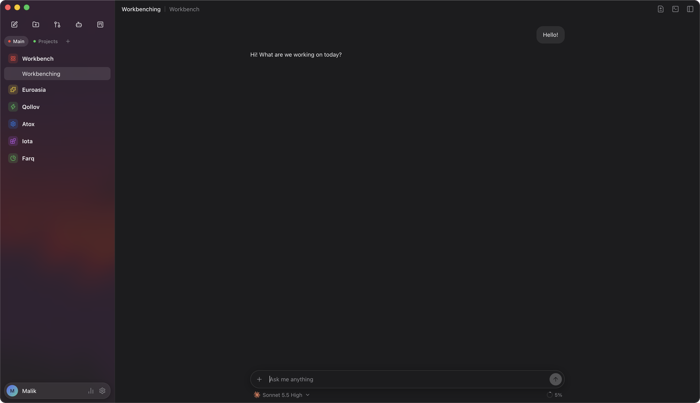

<p align="center">
  
</p>

<p align="center">
  <strong>One calm place to run Claude, Codex and any other agent together</strong><br>
  <sub>Orchestrate agents across models, watch them work</sub>
</p>

<p align="center">
  <a href="https://github.com/malikfattaev/Atox/releases/latest"></a>
  
  <a href="https://github.com/malikfattaev/Atox/actions/workflows/release.yml"></a>
  
  
  <a href="LICENSE"></a>
</p>

<p align="center">
  <a href="https://github.com/malikfattaev/Atox/releases/latest"><strong>Download</strong></a>
  &nbsp;&middot;&nbsp;
  <a href="#install"><strong>Install</strong></a>
  &nbsp;&middot;&nbsp;
  <a href="#what-it-does"><strong>Features</strong></a>
  &nbsp;&middot;&nbsp;
  <a href="https://github.com/malikfattaev/Atox/issues"><strong>Issues</strong></a>
</p>

<p align="center">
  
</p>

## What it does

- **Any agent, any moment.** Claude Code and Codex in one chat. Switch whenever you like.
- **Agents team up.** Claude can ask Codex for a review, and the answer comes back to the same chat.
- **A board for agents.** Drag a GitHub issue to the queue and an agent works on it in its own worktree.
- **Fork a chat.** Try another approach without losing the first one.
- **Changes and a terminal.** Review what agents changed, with a real shell next to the chat.
- **Chats remember.** Close Atox, come back, and every chat picks up where it left off.
- **Archive, don't lose.** Archived chats leave the sidebar but keep their history, ready to restore.
- **Projects and spaces.** A project is a folder, its chats live inside. Give it a color and one of 400+ icons.
- **Updates itself.** A new version is one click away.

## Install

**Mac:** download the `.dmg` from the [latest release](https://github.com/malikfattaev/Atox/releases/latest) (`arm64` for Apple Silicon, `x64` for Intel) and drag Atox to Applications.
The first time, macOS says it can't verify the developer: open System Settings → Privacy & Security and click "Open Anyway". Only once.

**Linux:** grab the `.AppImage` (any distro) or the `.pacman` (Arch) from the same release.

```bash
chmod +x Atox-*.AppImage && ./Atox-*.AppImage
```

## Privacy

Atox sends anonymous usage stats to its own server ([`stats/`](stats)) so we know how many people use it: an install event once, then one event per day, week and month the app is open. Each event carries only the app version, OS name and a random number for the current launch. The server keeps the country looked up from the IP address, not the address. No IDs, projects, files or chats are stored.

Turn it off any time in Settings → General.

## License

[MIT](LICENSE) © Malik Fattaev
